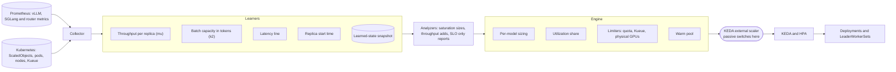

# llm-d-scaling-manager

[](LICENSE)
[](https://github.com/llm-d-incubation/llm-d-scaling-manager/actions/workflows/ci-pr-checks.yaml)
[](go.mod)

llm-d-scaling-manager sizes LLM inference fleets on llm-d, aggregated and
prefill/decode alike. It learns each model's capacity from its own servers
(throughput per replica, batch capacity, latency, start time) and orders the
replicas the load needs. Under a GPU quota it shares the GPUs between models
(**utilization share**, experimental: benchmarked with two models so far; see
[Why use it](docs/why.md#how-mature-each-part-is)): each model gets its need,
the spare goes by weight, and GPUs move as demand shifts. It can run
**passive** first and report what it would do without changing anything.
KEDA does the scaling.



Every 15 seconds it reads the metrics, updates what it has learned, works out
each model's need, fits it into the budget, and answers KEDA. In passive mode
the scaler answers with the current replica count, so nothing moves.
[How it fits together](docs/concepts/architecture.md).

## Start here

- **[The main path: share GPUs between models](docs/well-lit-paths/utilization-share/)**:
  install passive, watch, turn on sharing in shadow, then go active.
- **[Configuration](docs/reference/configuration.md)**: every setting, the
  ones to set for your setup and the ones to tune per model.
- **[How it decides](docs/concepts/architecture.md)**: the learners, the analyzers and the
  engine, in operator terms.
- **[Other scenarios](docs/well-lit-paths/)**: scale on saturation, scale to
  zero, warm pool, P/D, Kueue quotas and more.
- **[Why use it](docs/why.md)**: what it was measured to do, what it costs,
  and how mature each part is.

## Install

From a release, with `kubectl`, `curl` and docker; no checkout. You need llm-d
model servers in a namespace, KEDA and a Prometheus Operator. A cluster admin
runs the lines marked `# admin`. This installs it passive with a GPU quota, so
it decides and changes nothing. `<gpu product>` is the `GPU.PRODUCT` column of
`kubectl get nodes -L nvidia.com/gpu.product`.

```bash
V=<release, for example v0.11.0>
export NAMESPACE=<the namespace running llm-d>
URL=https://github.com/llm-d-incubation/llm-d-scaling-manager/releases/download/$V
for f in namespaced settings scaler-tls model-namespace keda-auth activate; do
  curl -fsSLO $URL/scaling-manager-$f.yaml
done
sed -i -e "s/__NAMESPACE__/$NAMESPACE/g" -e "s/__MODEL_NAMESPACE__/$NAMESPACE/g" scaling-manager-*.yaml
kubectl apply -f scaling-manager-namespaced.yaml -l scaling-manager.llmd.ai/part=admin   # admin
kubectl apply -f scaling-manager-model-namespace.yaml                                   # admin
# In scaling-manager-settings.yaml set prometheusURL, limiter: "quota" and
# quotas: "<gpu product>=<gpus>"; passive is already "true".
kubectl create -f scaling-manager-settings.yaml
kubectl create -f scaling-manager-scaler-tls.yaml
kubectl apply -f scaling-manager-namespaced.yaml -l scaling-manager.llmd.ai/part=controller
# admin: give KEDA its client certificate. This prints the commands to run.
kubectl get configmap scaling-manager-controller-status -n $NAMESPACE -o jsonpath='{.data.scalerTLSAction}{"\n"}'
```

Then register the model servers and turn sharing on in shadow, with the
release's tools image. The model servers must drain on termination, because
sharing scales a donor down; `workload-patch` writes what each one needs
([prepare model servers](docs/guides/prepare-workloads/)):

```bash
smt() { docker run --rm --user "$(id -u):$(id -g)" -v "$HOME/.kube/config:/kube/config:ro" \
  -v "$PWD:/work" ghcr.io/llm-d-incubation/llm-d-scaling-manager/tools:$V "$@"; }
smt workload-patch -n $NAMESPACE                         # what each model server still needs
smt scaledobjects-plan -n $NAMESPACE --out plan.yaml     # lists your model servers; edit it
smt scaledobjects-apply -n $NAMESPACE --plan plan.yaml   # registers them with KEDA
smt utilization-share check -n $NAMESPACE                # is there a budget to share?
kubectl patch configmap scaling-manager-settings -n $NAMESPACE --type merge \
  -p '{"data":{"utilizationShare":"shadow"}}'           # report what sharing would move
```

Leave it through each model's busy period and read what it would have done
(how: [per model](docs/guides/try-in-passive-mode/README.md#verification),
[for sharing](docs/guides/try-in-passive-mode/README.md#utilization-share-in-passive-mode)).
Then go active:

```bash
kubectl apply -f scaling-manager-activate.yaml           # admin: the one grant of patch on pods
kubectl patch configmap scaling-manager-settings -n $NAMESPACE --type merge \
  -p '{"data":{"passive":"false","utilizationShare":"active"}}'
```

Every step, with its checks: [install in a namespace](docs/guides/install-in-namespace/)
(or [for the whole cluster](docs/guides/install-cluster-wide/)),
[try it in passive mode](docs/guides/try-in-passive-mode/) and
[turn on utilization share](docs/guides/utilization-share/). Without a quota,
leave out `limiter`, `quotas` and the sharing steps: each model is then scaled
on its own. From a checkout instead: `make deploy-scaling-manager`
([installer options](docs/reference/install-options.md)).

## Contributing

See [CONTRIBUTING.md](CONTRIBUTING.md) and the
[developer guide](docs/developer-guide/development.md). Questions, bugs and
ideas: [GitHub issues](https://github.com/llm-d-incubation/llm-d-scaling-manager/issues).

## License

Apache 2.0 - see [LICENSE](LICENSE) for details.

## Origin

Started in 2026 from the code of llm-d's workload-variant-autoscaler; since
redesigned. Nearly 90% of the production Go code is new since August 2026,
and nothing has been taken from that project since. Not affiliated with or
endorsed by llm-d.

## Related Projects

- [llm-d-autoscaling](https://github.com/llm-d/llm-d-autoscaling) - llm-d's KEDA autoscaling blueprints
- [llm-d infrastructure](https://github.com/llm-d/llm-d-infra)
- [llm-d main repository](https://github.com/llm-d/llm-d)
