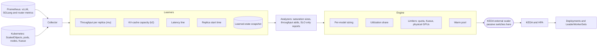
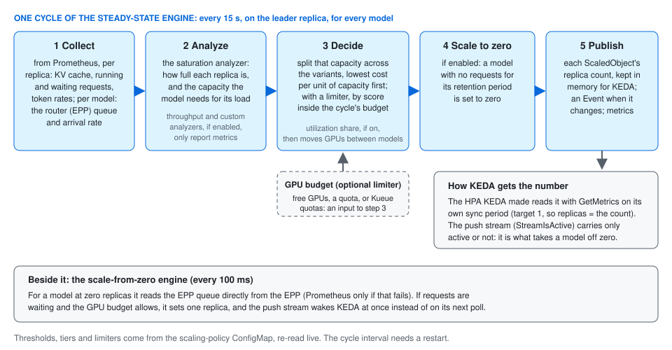

# How the scaling manager fits together

llm-d-scaling-manager decides how many replicas each LLM model server should
run. It reads how loaded the servers are, learns what one replica of each model
can serve, works out the replica count every model needs, keeps the total
inside a GPU budget if you set one, and hands the number to KEDA. KEDA and the
Kubernetes HPA do the actual scaling; the scaling manager never changes a
replica count itself.



The same picture with the serving path around it:


## The boxes, left to right

### What it reads

- **The serving path is llm-d's.** Clients send requests to a gateway. The
  EPP (endpoint picker, llm-d's router) chooses a replica for each request,
  and queues requests when every replica is busy. The model servers are vLLM
  or SGLang pods, run by a Deployment or a LeaderWorkerSet.
- **Prometheus** scrapes the model servers (KV-cache use, running and waiting
  requests, token counts, latency) and the EPP (its queue and arrival rate).
  The scaling manager reads all of it from Prometheus, never from the pods.
  For a model parked at zero it also reads the EPP's queue directly, so a
  waiting request wakes the model at once.
- **Kubernetes objects.** The ScaledObjects KEDA asks about (that is how a
  workload registers), the pods behind them, the GPU nodes, and Kueue's queues
  when you use Kueue.
- **The collector** turns those into one row per replica every cycle (15
  seconds by default).

### The learners

Fixed thresholds hold for one model and one request shape. Instead, the
learners measure each model on its own servers, per variant and per request
shape, and the analyzers size from what they measured. They are drawn apart
above, but they live inside the analyzers: most in the saturation analyzer,
with the throughput and SLO analyzers keeping latency lines of their own.

| Learner | What it measures | What it is used for |
| --- | --- | --- |
| Throughput per replica (mu) | The requests per second one replica completes at the current request shape | Pricing the load: how many replicas the arrival rate needs |
| KV-cache capacity (k2) | How full the KV cache gets when a replica is saturated | How much one replica holds before it is full |
| Latency line | How inter-token latency rises as a replica fills | Decode capacity, and a second estimate of throughput |
| Replica start time | Seconds from a new Pod to Ready | How far ahead to order, and how long a move takes |
| Learned-state snapshot | Everything above, written to the ConfigMap `scaling-manager-learned-state` | Keeping it across a restart. Off by default (`LEARNED_STATE_SNAPSHOT`); without it a restart relearns from cold |

A learner only counts readings from replicas that have settled, so a replica
that is starting, restarting or being borrowed from a warm pool does not
teach it a wrong figure. Until a learner has measured a variant, the variant is
sized from seeds on its trigger (`replicaStartSeconds`,
`defaultOutputTokens`) and from KV-cache use. To make it forget a variant, for
example after a model change, see
[reset one variant's learned state](../reference/troubleshooting.md#reset-one-variants-learned-state).

### The analyzers

- **Saturation** runs every cycle and sets the units: how full each replica is
  and how many replicas the model needs to stay under its scale-up threshold.
- **Throughput** (opt-in) sizes from token throughput and the latency line.
  When it is listed, the model gets the larger of the two needs.
- **SLO** (opt-in) reports what a latency target would need. It never changes
  a replica count.

### The engine

- **Per-model sizing** (the steady-state engine) splits each model's need across its variants. With no
  limiter it grows the variant with the lowest cost per unit of capacity
  (`variantCost`) first.
- **Limiters** bound every decision by a GPU budget: a quota you declare,
  Kueue's quotas, or the GPUs physically on the nodes. Without one, each model
  is sized on its own.
- **Utilization share** (opt-in, experimental) splits one limiter's budget
  between models: each gets its need, the spare is shared by weight, and GPUs
  move between models through an ordinary scale-down of one and scale-up of
  the other. It has its own shadow mode.
- **Warm pool** (opt-in) keeps models loaded and asleep, and lends one to a
  variant while its own new replica starts.

### KEDA and the external scaler

KEDA asks the scaling manager for each variant's replica count over gRPC (the
`scaling-manager-external-scaler` Service, port 9090), and the HPA that KEDA
created scales the workload to it. **Passive mode switches here**: everything
before the scaler runs as usual, and every decision is published, but the
scaler answers with the workload's current replica count (or, beside your own
triggers, with zero), so nothing moves. Passive is set for the whole
controller or per namespace, tier or model
([passive](../reference/scaling-policy.md#passive)).

Package by package, for contributors:
[which component owns which number](../developer-guide/signal-dataflow.md),
[the saturation analyzer and its learners](../developer-guide/saturation-analyzer.md),
[the throughput analyzer](../developer-guide/throughput-analyzer.md),
[the SLO analyzer](../developer-guide/slo-analyzer.md),
[how analyzers combine](../developer-guide/multi-analyzer-pipeline.md),
[how limiters combine](../developer-guide/limiter-composition.md).

## The unit it scales: one ScaledObject per variant

A **model** is what clients ask for by name. A **variant** is one way of
serving it, such as one GPU type or one serving configuration. Each variant
is one KEDA ScaledObject plus the workload it scales. Variants whose triggers
name the same `modelID` are sized together, as one model.

```yaml
apiVersion: keda.sh/v1alpha1
kind: ScaledObject
metadata:
  name: llama-8b-h100
spec:
  scaleTargetRef:
    name: llama-8b-h100          # the Deployment (or LeaderWorkerSet) to scale
  minReplicaCount: 1
  maxReplicaCount: 8
  triggers:
    - type: external-push
      metadata:
        scalerAddress: scaling-manager-external-scaler.<controller-namespace>.svc:9090
        modelID: meta-llama/Llama-3.1-8B-Instruct
        variantCost: "10"        # relative cost of one replica of this variant
      authenticationRef:      # TLS, the default. Plaintext install: ...svc.cluster.local:9090 and no authenticationRef
        name: scaling-manager-external-scaler-<controller-namespace>
        kind: ClusterTriggerAuthentication
```

`modelID` is the only field you must supply. The accelerator, the role
(prefill or decode), the GPUs per replica and the InferencePool are derived
from the workload, so they cannot drift from it.

You rarely write this by hand: `make scaledobjects-plan` lists the model
servers it finds and writes a plan to edit, and `make scaledobjects-apply`
creates the ScaledObjects. Creating the ScaledObject is the whole
registration; there is no other custom resource.

## One decision cycle



1. **Collect.** From Prometheus, per replica: KV-cache use, running and
   waiting requests, token rates. Per model: the router's queue and arrival
   rate.
2. **Analyze.** The saturation analyzer works out how full each replica is
   and how much capacity the model needs for its load. Every other analyzer
   the policy lists (throughput, a custom one) works out the replicas it needs
   too, and the model is sized to the largest of those needs, in saturation's
   units. The `slo` analyzer only observes and never changes the decision.
3. **Decide.** The optimizer splits that capacity across the model's
   variants. With no limiter it grows the variant with the lowest cost per
   unit of capacity (`variantCost` over what one replica serves) first. With
   a limiter, the GPU budget for this cycle (free GPUs, a quota, or Kueue
   quotas) is an input, and every model is fitted inside it by score. The
   [utilization-share optimizer](../well-lit-paths/utilization-share/)
   (experimental) then moves GPUs between the models of one quota.
4. **Scale to zero.** If enabled, a model with no requests for its retention
   period is set to zero.
5. **Publish.** Each ScaledObject's replica count is kept in memory for KEDA,
   with an Event on the ScaledObject when it changes, and metrics.

**How KEDA gets the number.** The HPA that KEDA created reads it through
`GetMetrics` on its own sync period; the metric's target is 1, so the replica
count is the number returned. The push stream (`StreamIsActive`) carries only
whether a variant is active, which is what takes it off zero.

**Beside the cycle, the scale-from-zero engine** checks every 100 ms whether a
model at zero has requests waiting in its EPP's queue, read directly from the
EPP. If it has, and the GPU budget allows, it sets one replica, and the push
stream wakes KEDA at once instead of on its next poll.

How each step decides, in detail: [the steady-state
engine](steady-state-engine.md) and [modeling and
optimization](modeling-and-optimization.md).

## Inside the scaling manager


- **It learns its workloads from KEDA.** Each call KEDA makes for a
  ScaledObject registers that ScaledObject; there is no list or watch of your
  workloads. It does watch the scaling-policy ConfigMaps and the
  InferencePools, to find each pool's EPP.
- **One replica decides.** With more than one replica, leader election picks
  one, and only it runs the engines. The external scaler runs on every
  replica, but answers KEDA only once its replica is the leader.
- **The decision lives in memory**, in the decision store, and is rebuilt
  within one cycle after a restart. Until then KEDA is answered each target's
  current replica count, read from its `scale` subresource, so the HPA holds
  every variant where it is: see
  [before the first decision](../reference/scaledobject-trigger.md#before-the-first-decision-and-the-fallback).
- **Package by package**, for contributors: [which component owns which
  number](../developer-guide/signal-dataflow.md).

## What gets installed

| Object | What it is for |
| --- | --- |
| Deployment `scaling-manager-controller-manager` | the scaling manager |
| Service `scaling-manager-external-scaler`, port 9090 | where KEDA asks for replica counts |
| Service `scaling-manager-controller-manager-metrics-service`, port 8443 | its own `llmsm_*` metrics, for Prometheus |
| ConfigMap `scaling-manager-scaling-policy-config` | thresholds, tiers, limiters; re-read live (at startup only, for a namespace-scoped controller reading it outside the namespace it manages) |
| ConfigMap `scaling-manager-manager-config` | Prometheus address and the cycle interval; changes need a restart |
| ConfigMap `scaling-manager-controller-status` | written by the controller: which policy it loaded and whether it accepted it, the limiter in force, the utilization-share mode |
| Roles and ClusterRoles | read pods, workloads, ScaledObjects, InferencePools, nodes and (optionally) Kueue queues; patch pods only in a namespace that runs a warm pool or the utilization-share optimizer. A namespace-scoped install's Role always carries `patch` on pods in the namespace it manages |

It has **no write access** to Deployments, ScaledObjects or HPAs. It patches
pods: annotations (the deletion cost that tells Kubernetes which pod to remove
first, and the marks of the utilization-share optimizer) and, with a warm pool,
the labels that put a pool pod into a model's InferencePool. It also writes
Events, a leader-election Lease and its own ConfigMaps.
Every identity, permission and port, by install scope: [security model](../reference/security-model.md).

The common install is **namespace-scoped**: one scaling manager per namespace,
managing only the model servers there. A cluster admin runs a one-time setup
for the cluster-wide pieces first. Both steps are in [install in a
namespace](../guides/install-in-namespace/). A [cluster-wide
install](../guides/install-cluster-wide/) runs one controller for every
namespace.

A cluster admin can also publish one policy in the `scaling-manager-policy` namespace.
Self-managed controllers read it in place of their own. Two kinds do not:

- a namespace-scoped controller on Kubernetes without the Namespace read that
  `make setup-prereqs` grants. It keeps its own ConfigMap and reports
  `llmsm_policy_namespace_unverified`.
- admin-owned controllers (cluster-scoped, or out of the tenant's reach). By
  design they read their own ConfigMap, which the admin's command writes for
  them.

Each controller logs at startup which source it took: [bound every install by
real GPUs](../guides/admin-gpu-bounding/).

## What it writes back

- **Metrics**, all named `llmsm_*`: desired and current replicas, saturation,
  GPU use, why a model is held back. The [monitoring
  page](../reference/monitoring.md) lists the ones that answer specific
  questions.
- **Events** on each ScaledObject: `ScaledUp`, `ScaledDown`, `ScaledToZero`,
  `ResourceConstrained`, `MetricsUnavailable`, and more.
- **Two log lines per model per cycle**, which say why it decided what it
  did: [the cycle log](../reference/cycle-log.md).

## Optional pieces

| Piece | What it does | Where |
| --- | --- | --- |
| Scale to zero | parks an idle model at zero replicas and wakes it when a request queues | [path](../well-lit-paths/scale-to-zero/) |
| Warm pool | keeps models loaded and asleep, and lends one to a variant while its own replica starts | [path](../well-lit-paths/warm-pool-bridge/) |
| GPU limiter | bounds every decision by the GPUs that are free (`gpu-inventory`; logged as `inventory`) | [path](../well-lit-paths/bound-by-gpus/) |
| Quota limiter | bounds each namespace, or the cluster, by a declared allowance | [path](../well-lit-paths/tenant-gpu-quotas/) |
| Kueue quotas | takes that allowance from Kueue's ClusterQueues (experimental) | [path](../well-lit-paths/kueue-bounded-quotas/) |
| Faster replica start | pre-pulls images, keeps weights and compile caches on each node | [preparing a workload](../reference/workload-preparation.md) |

## Next

- Install it: [in a namespace](../guides/install-in-namespace/).
- Pick the scenario that matches yours: [well-lit paths](../well-lit-paths/).
- Something does not scale: [troubleshooting](../reference/troubleshooting.md).
